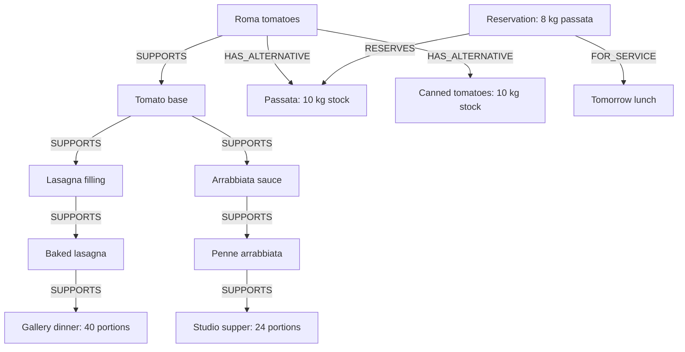

# Savora Kitchen Rescue

When an ingredient delivery is delayed, which meals depend on it, and what can the kitchen prepare instead? Savora follows those dependencies in FalkorDB, checks replacement ingredients against existing stock reservations and service times, and presents a recovery plan for human approval.

Built for Graph Hacks Track 01, Agents That Act on Connected Data. The demo uses fictional quantities, recipes and timings. It is not food-safety advice or production kitchen software.

## Run locally

No Docker, cloud database or model key is required. You need Node.js 22.12+, npm, native Redis on PATH, and the native FalkorDB module used by FalkorDBLite. The tested platform is macOS arm64. Linux x64 is supported upstream but has not been tested for this project.

1. Clone the repository to a short path, such as ~/savora, to stay within Unix socket path limits.
2. Install native Redis if needed. On macOS, use `brew install redis`. Do not start brew services; Savora manages its own private Redis process.
3. Run `npm ci`, then `npm run dev`. Open http://127.0.0.1:5180.
4. For a local production build, run `npm run build`, then `npm start`. Open http://127.0.0.1:4319.
5. Run `npm test` for graph, API, MCP and lifecycle tests. Run `npm run test:packaging` to check source-package safeguards. Tests make no model API calls.

FalkorDBLite 0.3.0's optional macOS binary package was unusable on the development machine. Native Redis plus the official FalkorDB module download worked. Installation may require internet access, OpenSSL libraries or libomp. Tests and builds reused installed dependencies; a fresh `npm ci` and a fresh-machine installation remain unverified. See [runtime notes](RUNTIME.md) for details.

Both servers bind to loopback. The database uses a private Unix socket with TCP disabled and persists data in .kitchen-data. To try a fresh scenario, set KITCHEN_DATA_DIR to a new empty directory instead of deleting prior approvals. Normal shutdown releases .savora.lock. After a hard crash, confirm the old process has stopped before recovering a stale lock.

## Graph model and recovery

Savora traverses Ingredient → shared base → preparation → dish → service paths using variable-length Cypher. Alternative ingredients, stock reservations and service timing are also graph facts. Missing or invalid facts block a proposal rather than being filled in by the model.

### Graph at a glance

Every food, preparation and service node shown has the `KitchenNode` label; ingredients also have `Ingredient`. Base, preparation, dish and service are `kind` property values, not separate labels. The reservation has the `Reservation` label.

- `trace_recipe_impact` follows `SUPPORTS` paths in FalkorDB: one hop reaches Tomato base; four hops reaches both dinners. Returned paths explain the two services and 64 connected portions.
- `inspect_stock_reservations` follows `HAS_ALTERNATIVE`, then incoming `RESERVES` and outgoing `FOR_SERVICE` relationships. Passata needs 8 kg but has only 2 kg free after tomorrow's 8 kg reservation. Canned tomatoes need 9 kg of the 10 kg available. Required batch quantities are properties of `HAS_ALTERNATIVE`.

These are the fictional scenario's stored relationships, not a model-generated explanation. The graph-backed queries and human-only approval behavior are described below.

The [graph store](kitchen/store.mjs) contains the parameterized Cypher queries, stock checks and atomic approval mutation. The [data model and API contract](kitchen/CONTRACT.md) describes the relationships and response shapes. [Graph tests](kitchen/store.test.mjs) and [end-to-end tests](kitchen/integration.test.mjs) check that changed graph facts change or block the result.

The [agent](kitchen/agent.mjs) calls tools through the MCP SDK's local InMemoryTransport. This is local MCP, not an externally hosted endpoint. Without Gemini configuration, guided mode calls those tools deterministically and is labeled as such. With Gemini enabled, the model selects permitted read and proposal tools; it cannot invent Cypher or recipes.

Approval is human-only and is not exposed as a model tool. A separate local HTTP endpoint checks the server-owned proposal, current stock and revision, then atomically records the reservation, preparation tasks and audit event. Repeated approval requests return the existing receipt. The model cannot approve, reserve stock, purchase ingredients or message suppliers.

## Optional Gemini

Use [CONFIGURATION.example.txt](CONFIGURATION.example.txt) to create a private .env.kitchen. Check your project's free tier, billing and quota before enabling the model. Savora cannot verify billing or guarantee free API use. It does not buy credits, enable billing or switch to a paid fallback. Keep credentials private and use only fictional data.

The [verification record](kitchen/VERIFICATION.md) documents live Gemini investigation and recovery-tool selection on 18 October 2026. Approval and persistence browser checks used guided mode. Each run reports its actual mode, including a guided fallback if needed.

## Try the scenario

Ask about delayed Roma tomatoes at one hop, then four. At one hop, downstream service impact is not evaluated. Four hops connects two services and 64 portions. Review the passata conflict: 10 kg on hand minus 8 kg reserved leaves 2 kg against an 8 kg requirement. Canned tomatoes require 9 kg of the 10 kg available. Review the timing assumptions, approve the plan, then reload to see the saved preparation tasks. Ask about truffle to see how an unmodeled ingredient is handled.

## Limits and attribution

Savora is a single-user local demo. It has no multi-user authorization and is not safe for a public writable deployment. It does not send supplier messages, place purchases or infer allergens or food safety. The graph is bounded to four hops; missing coverage is not evidence that a service is unaffected.

The tomato photograph is a real photograph by Dilara on Pexels, not an AI-generated image. It illustrates the interface and does not establish the tomato variety. See [asset attribution and license](ASSET_LICENSES.md). Dependencies retain their own licenses; no project source-code license has been selected.
